# AWS EC2 Cloud Security Homelab

**Hands-on cloud infrastructure, Linux security hardening, and security monitoring on Amazon Web Services.**

**Project status:** Lab deployment, SSH/UFW checks, Nginx hosting, CloudWatch and CloudTrail review completed.  
**Environment:** AWS Free Plan project · Asia Pacific (Sydney), `ap-southeast-2` · October 2026.

> **Portfolio note:** All screenshots are from my own AWS homelab. Public IP addresses and selected identifiers have been redacted before publishing. This is a learning environment, **not** a production-hardened website. Some remaining security improvements are documented below.

## Project overview

This project demonstrates how I provisioned an Ubuntu Linux virtual server in AWS, accessed it securely from Windows PowerShell using an SSH key, hosted a basic website with Nginx, added operating-system firewall rules, and inspected monitoring and audit information.

### What I built

| Area | Implementation | Evidence |
| --- | --- | --- |
| Compute | Amazon EC2 `t3.micro`; Ubuntu Server 26.04 LTS (64-bit x86) | [Instance running](screenshots/03-ec2-instance-running.png) |
| Storage | 8 GiB EBS `gp3` root volume | [Launch configuration](screenshots/01-ec2-launch-configuration.png) |
| Network | Default VPC, auto-assigned public IPv4, security group | [Network rules](screenshots/02-network-security-group.png) |
| Remote access | RSA `.pem` SSH key, Windows PowerShell, Ubuntu user | [SSH session](screenshots/04-ssh-connection-success.png) |
| Web server | Nginx; custom static HTML page over HTTP | [Deployed website](screenshots/07-custom-website-deployment.png) |
| Linux firewall | UFW enabled; deny incoming by default; TCP 22/80 allowed | [UFW rules](screenshots/09-ufw-active-firewall-rules.png) |
| Linux SSH audit | Password SSH disabled; public-key SSH enabled | [Effective SSH settings](screenshots/08-ssh-authentication-audit.png) |
| AWS monitoring | EC2 CloudWatch CPU and network metrics | [Metrics](screenshots/10-cloudwatch-cpu-network.png) |
| AWS audit | CloudTrail Event history with `RunInstances` event | [Event](screenshots/11-cloudtrail-runinstances-event.png) |

## Architecture

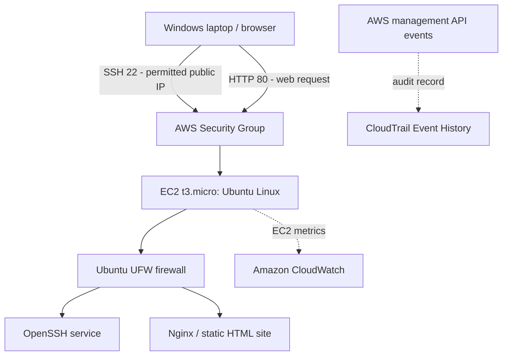

**Network controls:** The AWS security group limits SSH inbound traffic to my public IP and allows HTTP on port 80 from the internet. UFW additionally permits TCP 22/80 and blocks other inbound traffic by default. UFW permits port 22 broadly at the OS layer, so the AWS security group remains important for restricting the source IP.

## Deployment walkthrough with actual screenshots

### Phase 1 — Provision an EC2 Ubuntu server

Created the `AWS-Ubuntu-Security-Lab` instance with a `t3.micro` virtual machine, Ubuntu Server 26.04 LTS, a private RSA key pair and 8 GiB `gp3` root storage. Launched it in the AWS-assigned Sydney Region.

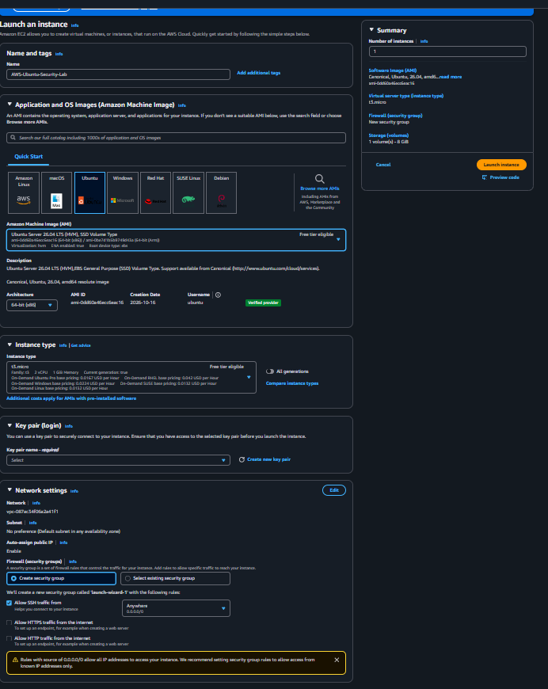

**Security group rules:** SSH (TCP 22) from **My IP**, and HTTP (TCP 80) from **Anywhere IPv4** for the demo website.

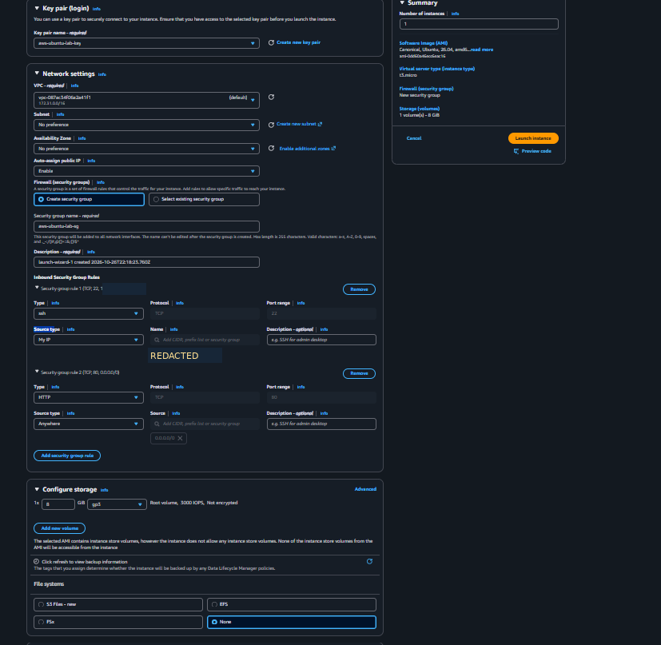

**Result:** Instance reached `Running` state. The screenshot captured it during the initial status-check period.

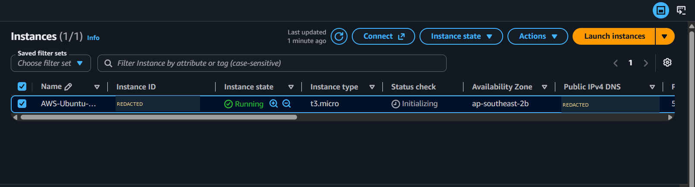

### Phase 2 — Connect using SSH from Windows

Used an RSA `.pem` private key from a local Windows computer. A private VPC IP address cannot normally be reached directly from a home internet connection, so I connected using the EC2 **public IPv4** address.

```powershell
# Run in Windows PowerShell (replace placeholder; never commit your private key)
cd $HOME\Downloads
ssh -i ".\aws-ubuntu-lab-key.pem" ubuntu@<PUBLIC_IPV4>
```

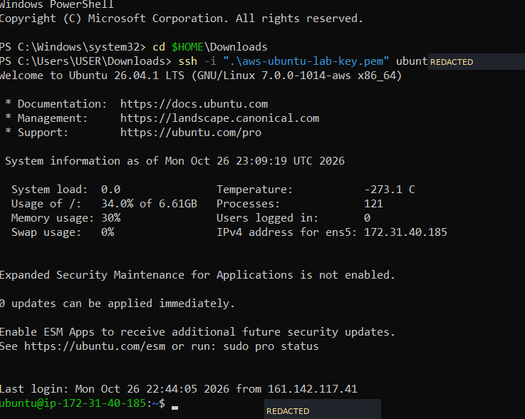

### Phase 3 — Install Nginx and deploy a website

```bash
sudo apt update
sudo apt install nginx -y
sudo systemctl status nginx
```

**Result:** `nginx.service` reported `active (running)`.

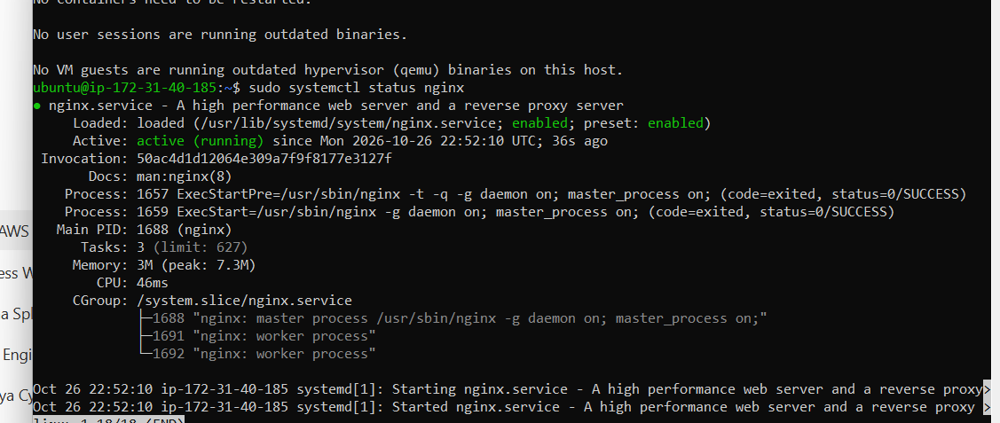

First, the server returned the default Nginx landing page:

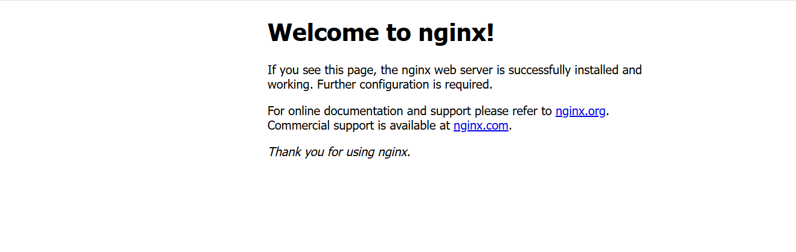

I then replaced `/var/www/html/index.html` with a small custom page (source provided in [`website/index.html`](website/index.html)). The page was accessible via `http://<PUBLIC_IPV4>`:

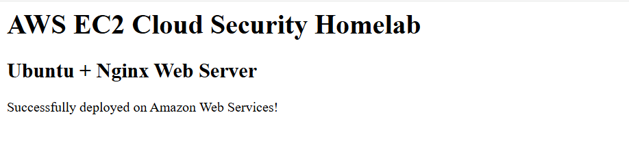

**Note:** The browser showed **Not secure**, as this demo used HTTP rather than TLS/HTTPS. Do not use this setup for sensitive user data.

### Phase 4 — Check SSH authentication and enable UFW

I examined the effective SSH settings without changing them:

```bash
sudo sshd -T | grep -E '^(passwordauthentication|pubkeyauthentication|permitrootlogin) '
sudo journalctl -u ssh --no-pager -n 20
```

Observed: `passwordauthentication no`, `pubkeyauthentication yes`, and `permitrootlogin prohibit-password`. The SSH logs contained an **Accepted publickey** entry for the `ubuntu` account.

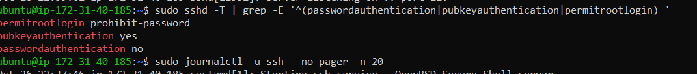

Configured UFW, ensuring SSH was allowed *before* enabling the firewall:

```bash
sudo ufw allow 22/tcp
sudo ufw allow 80/tcp
sudo ufw default deny incoming
sudo ufw default allow outgoing
sudo ufw show added
sudo ufw enable
sudo ufw status verbose
```

**Result:** UFW was active, logging was enabled at `low`, and both SSH and HTTP rules were present. A second PowerShell SSH connection succeeded after enabling UFW, confirming continued remote access.

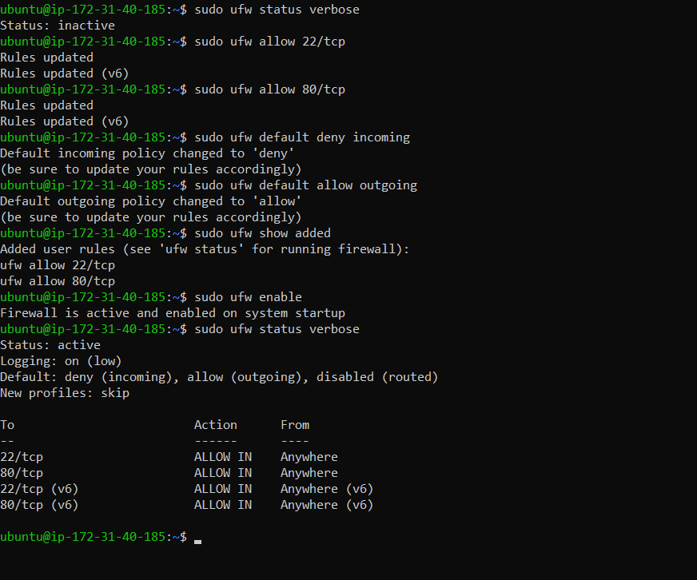

### Phase 5 — Monitor EC2 in CloudWatch

Opened the EC2 **Monitoring** tab to review CPU utilization, network bytes in/out and incoming network packets. The captured chart shows a short CPU peak around 10% and periods of network activity.

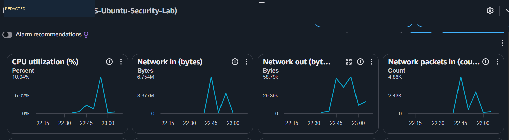

These metrics describe resource usage. **They do not, by themselves, establish whether the instance was attacked.** Detailed monitoring was not enabled.

### Phase 6 — Inspect AWS CloudTrail Event History

In **CloudTrail → Event history**, filtered by `Event name = RunInstances` and located the API event for launching the lab instance.

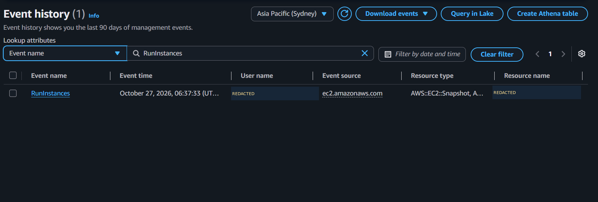

A review of the event JSON showed the AWS API action (`RunInstances`), Region, assumed-role caller context, EC2 instance settings and the initial `pending` state. See [CloudTrail security analysis](docs/CLOUDTRAIL-ANALYSIS.md) for a **sanitized** explanation. **The original event record is intentionally excluded from this repository.**

## Security findings and limitations

| Finding | Evidence / context | Status |
| --- | --- | --- |
| SSH password login disabled | Effective SSH config: `passwordauthentication no` | Implemented |
| SSH public-key authentication enabled | `pubkeyauthentication yes`, successful reconnection | Implemented |
| OS firewall active | UFW: deny incoming; port 22/80 allowed | Implemented |
| SSH restricted at AWS security-group layer | Source type `My IP` | Implemented at setup |
| IMDSv2 required | CloudTrail launch request: `httpTokens: required` | Configured at launch |
| Root EBS encryption | CloudTrail: `encrypted: false` | **Improvement needed** |
| Website transport encryption | HTTP (not HTTPS) | **Improvement needed** |
| Root SSH login restriction | `prohibit-password` still permits key-based root login if authorized | **Review in future** |
| MFA in assumed-role session context | CloudTrail showed `mfaAuthenticated: false`; not definitive for end-to-end authentication | **Verify account-level MFA** |
| Burstable instance credit mode | EC2 launch config used `cpuCredits: unlimited` | **Monitor credit usage** |

See [Security review and next steps](docs/SECURITY-REVIEW.md).

## Skills demonstrated

- AWS EC2 provisioning; VPC, public/private addressing and security groups.
- Linux administration, package updates and Nginx service management.
- SSH key-based administration and effective-config checks.
- UFW firewall policy configuration and post-change connectivity validation.
- CloudWatch performance monitoring and CloudTrail audit-event investigation.
- Basic cloud cost awareness and safe GitHub documentation.

## Cost and cleanup notes

This lab used an AWS **Free Plan with promotional credits**. Eligible services can still consume credits, and resource lifecycle matters. When the lab is not needed, stop the instance to reduce compute consumption; EBS volumes can continue using credits or incur charges under paid plans. Terminate and clean up resources when permanently finished. Remember that a public IPv4 address may change after stopping and restarting an instance.

## Repository structure

```text
AWS-EC2-Cloud-Security-Homelab/
├── README.md
├── .gitignore
├── docs/
│   ├── CLOUDTRAIL-ANALYSIS.md
│   ├── SECURITY-REVIEW.md
│   └── GITHUB-UPLOAD-GUIDE.md
├── website/
│   └── index.html
└── screenshots/
    ├── 01-ec2-launch-configuration.png
    ├── 02-network-security-group.png
    ├── 03-ec2-instance-running.png
    ├── 04-ssh-connection-success.png
    ├── 05-nginx-service-running.png
    ├── 06-nginx-default-website.png
    ├── 07-custom-website-deployment.png
    ├── 08-ssh-authentication-audit.png
    ├── 09-ufw-active-firewall-rules.png
    ├── 10-cloudwatch-cpu-network.png
    └── 11-cloudtrail-runinstances-event.png
```

---

*This repository documents a personal, educational AWS cloud security homelab. Screenshots and conclusions reflect the state observed during the October 2026 lab session.*
